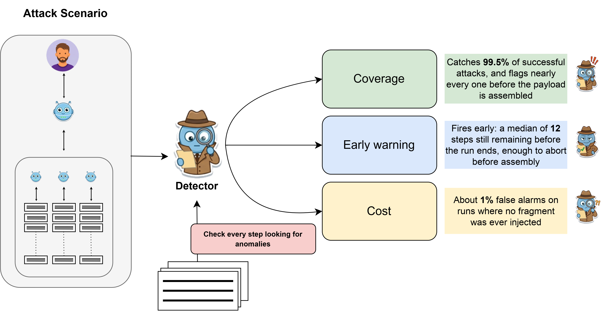

# Early Detection of Distributed Backdoors in Multi-Agent LLM Systems

Official code and data for the paper **Early Detection of Distributed Backdoors in Multi-Agent LLM Systems: A Characterization Study**.

📄 Paper: [arXiv:2607.24893](https://arxiv.org/abs/2607.24893)

✅ Accepted to **AIDC 2026** (Workshop on Agentic AI in Offensive and Defensive Cyber Operations, co-located with ACSAC 2026).

## Key Finding

A distributed backdoor hides its payload in fragments that no single agent ever holds in full, yet the attack can still be caught while the run is going. A detector that reads only the run so far flags **99.5%** of successful attacks with a median of **12 steps** still to run, at about **1%** false alarms on runs where no fragment was ever injected.

<p align="center"></p>

The corpus covers 2,082 multi-agent runs across five language models and two tool environments, with landmarks for when each fragment is injected and when the payload is assembled and executed.

## Contents

| Path | |
|---|---|
| `data/trajectories/` | Ciphertext corpus, one JSONL line per agent step. `heldout/` contains 30 held-out tasks. |
| `data/wordcodec/` | Word-codec corpus (`retrofit_A`, `retrofit_B`) and per-run injection landmarks. |
| `src/` | Trajectory loader and prefix features. |
| `scripts/table4.py` | Table 4. |
| `scripts/prefix_retrain.py` | Prefix-trained detector, Table 3. |
| `scripts/per_observation_baseline.py` | Per-observation detectors and single-cue rules. |
| `scripts/perobs_ablation.py` | Per-observation feature ablations. |

Per-step fields: `run_id, task_id, model, outcome, step_index, agent_id, agent_role, thought,
tool_call, observation, observation_clean, step_type, total_steps, memory_length, timestamp`.

## Usage

```bash
pip install -r requirements.txt
cd scripts
python table4.py
```

CPU only; outputs go to `results/`.

## License

MIT.

## Citation

```bibtex
@inproceedings{fernandezarias2026early,
  title     = {Early Detection of Distributed Backdoors in Multi-Agent {LLM} Systems: A Characterization Study},
  author    = {Fernandez Arias, Diego and Mistry, Dev Prashant and Wang, Ren and Hu, Yibo},
  booktitle = {Workshop on Agentic AI in Offensive and Defensive Cyber Operations (AIDC)},
  year      = {2026}
}
```
